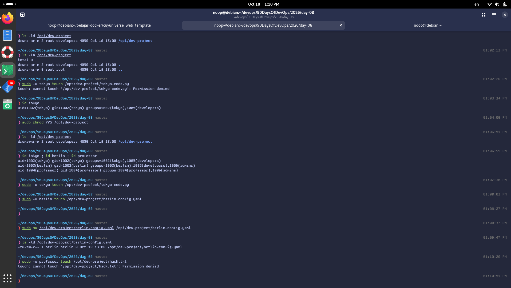
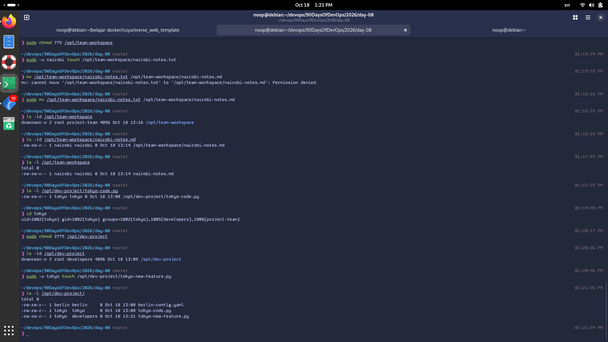

# 👥 Day 09: Linux User & Group Management Challenge

- **Target Pembelajaran:** Penguasaan Administrasi Pengguna, Pengelompokan Hak Akses (Group RBAC), dan Direktori Kolaborasi Tingkat Lanjut (SGID)
- **Studi Kasus:** Multi-Engineer Collaboration Workspace (`/opt/dev-project` & `/opt/team-workspace`)
- **Lingkungan Uji:** Debian GNU/Linux 13 (Kernel 6.12.x, x86_64)
- **Standar Industri:** Principle of Least Privilege, Access Isolation, Group Inheritance Automation (SGID)

---

## 🧭 Bagian 1: Pembuatan Pengguna & Matriks Keanggotaan Grup

Pengguna dibuat dengan parameter produksi terstandarisasi: `-m` untuk membuat direktori home terisolasi dan `-s /bin/bash` agar interaktif shell berfungsi optimal.

### 1. Perintah Eksekusi Penyediaan User & Group
```bash
# Pembuatan Akun
sudo useradd -m -s /bin/bash tokyo
sudo useradd -m -s /bin/bash berlin
sudo useradd -m -s /bin/bash professor
sudo useradd -m -s /bin/bash nairobi

# Pembuatan Grup
sudo groupadd developers
sudo groupadd admins
sudo groupadd project-team

# Penetapan Grup Tambahan (-aG)
sudo usermod -aG developers,project-team tokyo
sudo usermod -aG developers,admins berlin
sudo usermod -aG admins professor
sudo usermod -aG project-team nairobi
```

---

### 2. Verifikasi Keanggotaan Grup (Bukti Terminal Nyata)
Perintah verifikasi dieksekusi berurutan:
```bash
id tokyo ; id berlin ; id professor
```

**Output Nyata:**
```text
uid=1002(tokyo) gid=1002(tokyo) groups=1002(tokyo),1005(developers),1008(project-team)
uid=1003(berlin) gid=1003(berlin) groups=1003(berlin),1005(developers),1006(admins)
uid=1004(professor) gid=1004(professor) groups=1004(professor),1006(admins)
```

**Matriks Peran Pengguna:**
| Pengguna | UID / GID | Grup Tambahan | Peran / Hak Akses Sistem |
| :--- | :--- | :--- | :--- |
| **tokyo** | `1002 / 1002` | `developers`, `project-team` | Software Engineer & Tim Kolaborasi Proyek |
| **berlin** | `1003 / 1003` | `developers`, `admins` | Tech Lead / Senior Engineer (Akses Dev & Admin) |
| **professor** | `1004 / 1004` | `admins` | Superadmin / System Architect |
| **nairobi** | `1005 / 1005` | `project-team` | Project Specialist / Kolaborator Tim |

---

## 🛠️ Bagian 2: Konfigurasi Shared Workspace & Isolasi Hak Akses

### 1. Analisis Kasus Troubleshooting: `chmod 755` vs `chmod 775`
Pada pengujian awal direktori `/opt/dev-project`, terjadi insiden error saat Tokyo mencoba membuat file:
```text
touch: cannot touch '/opt/dev-project/tokyo-code.py': Permission denied
```

**Root Cause Analysis (RCA):**
- Direktori secara tidak sengaja diatur ke permission `755` (`drwxr-xr-x`).
- Digit kedua (`5`) memberikan hak grup `r-x` (hanya Read dan Execute, tanpa izin **Write** `w`).
- Meskipun Tokyo terdaftar di grup `developers`, ketiadaan bit `w` menyebabkan penolakan penulisan file baru.

**Solusi & Remediasi:**
Direktori diperbaiki ke permission `775` (`drwxrwxr-x`):
```bash
sudo chmod 775 /opt/dev-project
sudo chgrp developers /opt/dev-project
```

---

### 2. Pengujian Hak Akses Lintas Pengguna (Bukti Terminal Nyata)

#### A. Direktori `/opt/dev-project` (Grup `developers`)
```bash
# 1. Tokyo membuat file kode (Berhasil)
sudo -u tokyo touch /opt/dev-project/tokyo-code.py

# 2. Berlin membuat file konfigurasi (Berhasil)
sudo -u berlin touch /opt/dev-project/berlin-config.yaml

# 3. Professor (bukan anggota developers) mencoba membuat file
sudo -u professor touch /opt/dev-project/hack.txt
```

**Output Nyata Isolasi Keamanan:**
```text
touch: cannot touch '/opt/dev-project/hack.txt': Permission denied
```
> 🛡️ **Validasi Keamanan:** Terbukti bahwa pengguna di luar grup `developers` (`professor`) ditolak secara absolut oleh sistem operasi.

---

#### B. Direktori `/opt/team-workspace` (Grup `project-team`)
```bash
sudo mkdir -p /opt/team-workspace
sudo chgrp project-team /opt/team-workspace
sudo chmod 775 /opt/team-workspace

# Nairobi membuat dokumen catatan kerja (Berhasil)
sudo -u nairobi touch /opt/team-workspace/nairobi-notes.md
```

**Output Nyata Direktori:**
```text
drwxrwxr-x 2 root project-team 4096 Oct 18 13:16 /opt/team-workspace
-rw-rw-r-- 1 nairobi nairobi      0 Oct 18 13:14 nairobi-notes.md
```

---

### 📸 Bukti Tangkapan Layar Terminal (Task 4: Pengujian Hak Akses & Isolasi)


---

## 🚀 Bagian 3: Studi Kasus Lanjutan – Penerapan SGID (`chmod 2775`)

### Permasalahan Nyata di Industri:
Sebelum SGID diterapkan, setiap berkas yang dibuat oleh Tokyo dimiliki oleh grup primer Tokyo:
```text
-rw-rw-r-- 1 tokyo tokyo 0 Oct 18 13:08 /opt/dev-project/tokyo-code.py
```
Hal ini menghambat kolaborasi karena Berlin tidak memiliki izin memodifikasi berkas tersebut secara penuh.

### Penerapan Bit SGID (Set Group ID):
```bash
sudo chmod 2775 /opt/dev-project
```

**Verifikasi Status Direktori:**
```bash
ls -ld /opt/dev-project
```
**Output Nyata:**
```text
drwxrwsr-x 2 root developers 4096 Oct 18 13:09 /opt/dev-project
```
*(Bit `s` pada kolom group menunjukkan SGID aktif).*

### Pengujian Otomasi Pewarisan Grup:
```bash
sudo -u tokyo touch /opt/dev-project/tokyo-new-feature.py
ls -l /opt/dev-project/
```

**Output Nyata Bukti Keberhasilan:**
```text
total 0
-rw-rw-r-- 1 berlin berlin     0 Oct 18 13:08 berlin-config.yaml
-rw-rw-r-- 1 tokyo  tokyo      0 Oct 18 13:08 tokyo-code.py
-rw-rw-r-- 1 tokyo  developers 0 Oct 18 13:21 tokyo-new-feature.py
```
> 💡 **Analisis Hasil:** Berkas `tokyo-new-feature.py` otomatis mewarisi kepemilikan grup `developers` tanpa perlu campur tangan manual `chgrp`! Seluruh anggota grup `developers` kini dapat berkolaborasi tanpa hambatan hak akses.

---

### 📸 Bukti Tangkapan Layar Terminal (Task 5 & Pembuktian SGID)


---

## 📋 Bagian 4: Ringkasan Perintah Penting (Command Toolkit)

- `sudo useradd -m -s /bin/bash <user>` : Menambahkan pengguna baru lengkap dengan folder home dan shell interaktif.
- `sudo groupadd <group>` : Membuat grup sistem baru.
- `sudo usermod -aG <group1,group2> <user>` : Memasukkan pengguna ke grup tambahan tanpa menghapus keanggotaan grup sebelumnya.
- `id <user>` : Memeriksa UID, GID, dan seluruh keanggotaan grup dari suatu user.
- `sudo chgrp <group> <path>` : Mengubah kepemilikan grup pada direktori atau file.
- `sudo chmod 775 <path>` : Memberikan izin penuh (Read, Write, Execute) bagi Owner dan Group, serta Read-Execute bagi pihak lain.
- `sudo chmod 2775 <path>` : Mengaktifkan bit SGID pada direktori agar berkas turunan otomatis mewarisi grup induk.
- `sudo -u <user> <command>` : Mengeksekusi perintah dengan konteks otorisasi pengguna lain untuk tujuan pengujian.

---

## 💡 Bagian 5: Pelajaran Kunci (Key Takeaways)

1. **Pemahaman Mendalam Oktal Permission:** Memahami arti tiap digit (4-Read, 2-Write, 1-Execute) sehingga dapat langsung mendiagnosis mengapa `755` gagal dan `775` berhasil untuk kebutuhan kolaborasi.
2. **Pentingnya Flag `-a` pada `usermod`:** Jika menggunakan `-G` tanpa `-a` (*append*), sistem akan menghapus seluruh grup sekunder lama dari user tersebut.
3. **Efisiensi Kolaborasi dengan SGID:** SGID (`2xxx`) adalah solusi standar industri pada server Linux multi-developer dan shared deployment directory untuk mencegah masalah *permission clash*.
